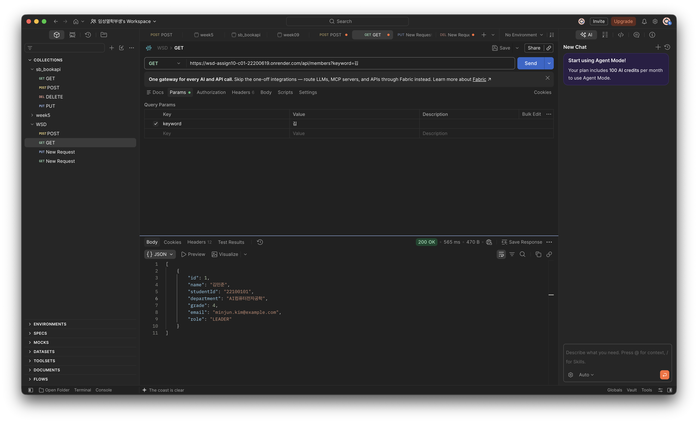
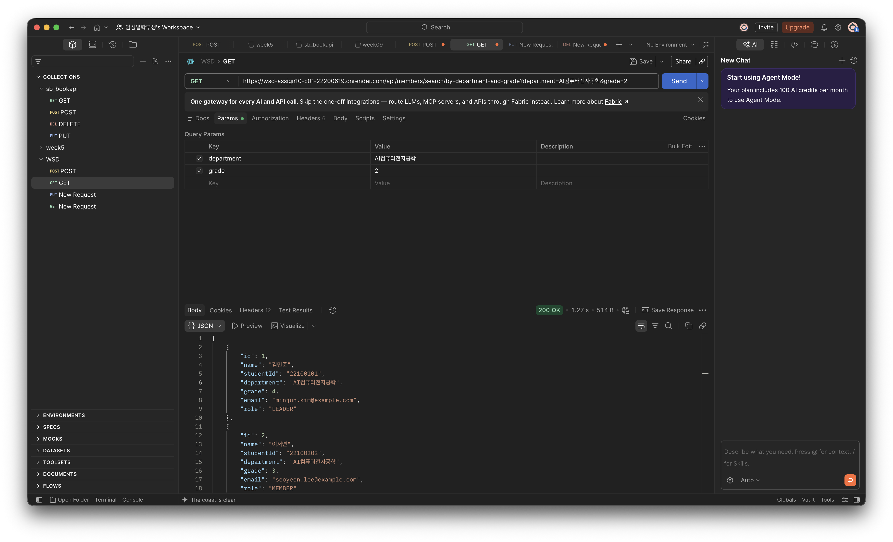
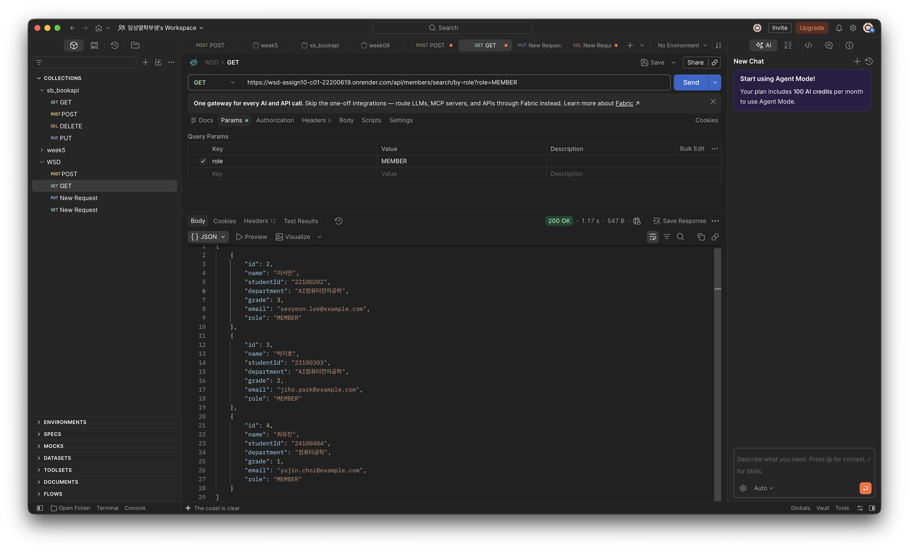
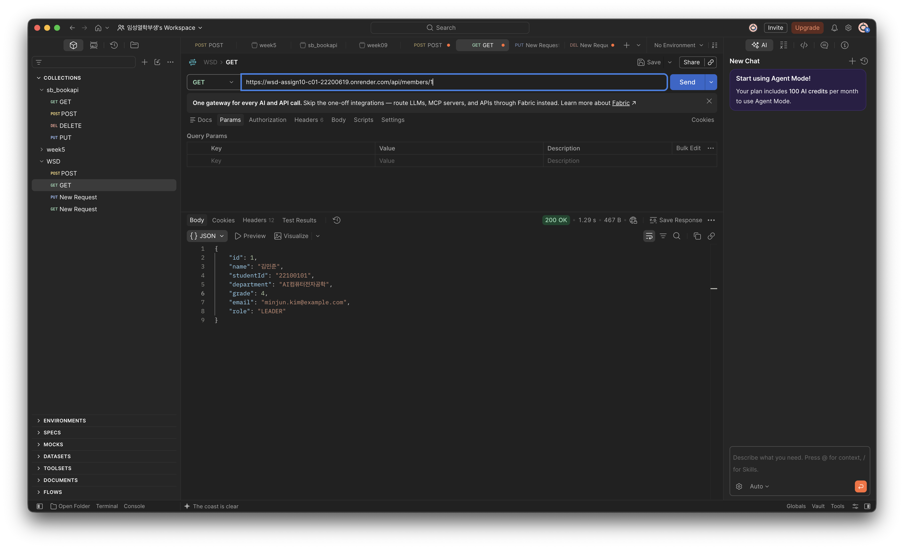
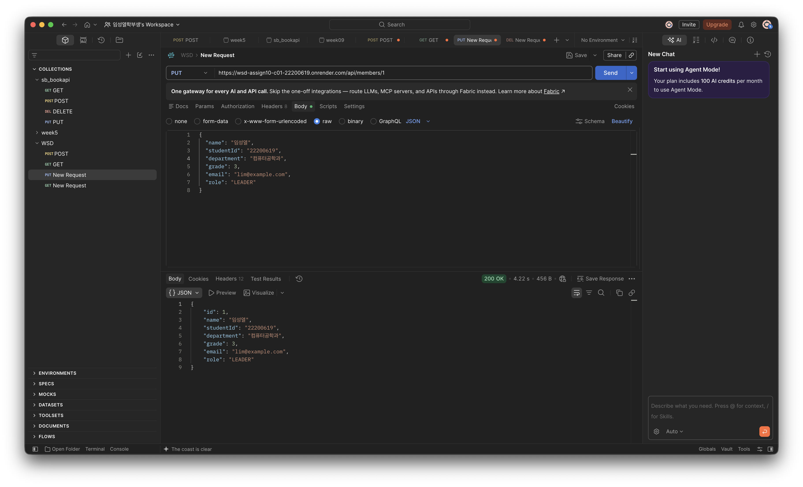
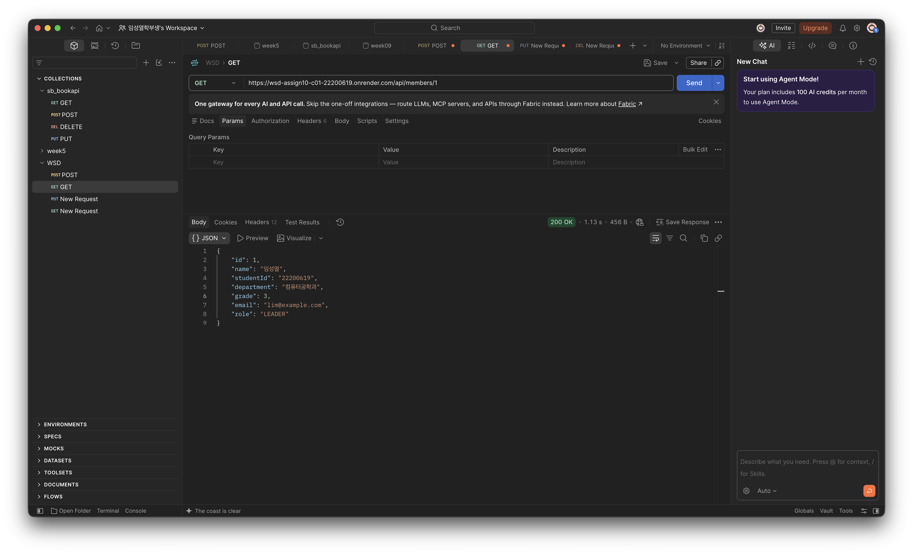
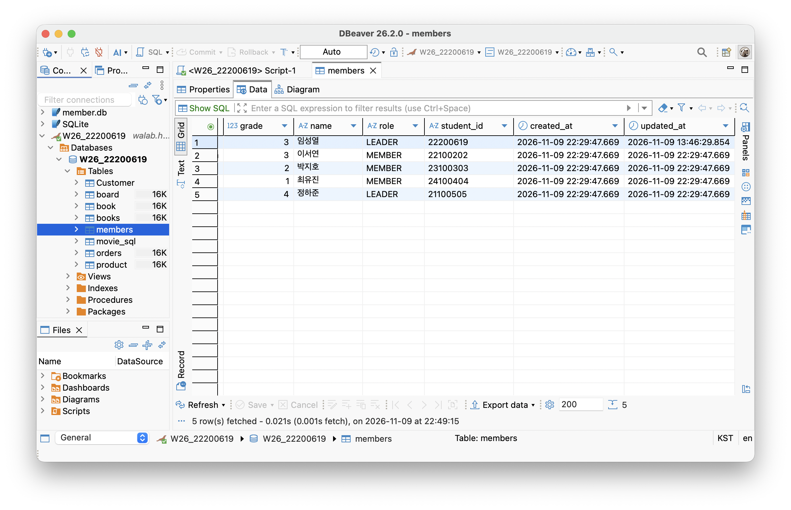

# Week 10 - 동아리 멤버 관리 

## 1. 프로젝트 소개
### 주제 및 주요 기능
- 동아리 멤버의 이름, 학번, 학과, 학년, 이메일, 직책을 관리하는 Spring Boot REST API이다.
- 기존 등록·조회·수정·삭제 기능에 조건별 검색과 정렬 기능을 추가했다. 
- 수정 기능에는 Dirty Checking을 적용하고, Auditing으로 생성 시간과 수정 시간을 자동 관리하도록 구현했다.

### **Render Deployment URL:** 
https://wsd-assign10-c01-22200619.onrender.com/api/members
### **GitHub Repository:** 
https://github.com/2026-2-WebService/assign10-c01-22200619.git

## 2. 주요 구현 내용 및 결과

### 2.1 Query Method 검색 및 정렬
- MemberRepository에 Query Method 3개를 구현하고, Service와 Controller를 연결했다.

| 구분 | Query Method                         | 검색 조건 |
|---|--------------------------------------|---|
| 단일 조건 | findByNameContainingIgnoreCase       | 이름에 검색어가 포함된 멤버 조회. 영문 대소문자 구분 없음 |
| 복합 조건 | findByDepartmentAndGradeGreaterThan  | 학과가 일치하고 입력한 학년보다 높은 멤버 조회 |
| 검색 및 정렬 | findByRoleOrderByGradeDesc         | 직책이 일치하는 멤버를 학년 내림차순으로 조회 |

#### API 실행 결과
##### 1. 단일 조건 - 이름 검색 (https://wsd-assign10-c01-22200619.onrender.com/api/members?keyword=김)
- 
##### 2. 복합 조건 - 학과 검색 / 학년 검색 (https://wsd-assign10-c01-22200619.onrender.com/api/members/search/by-department-and-grade?department=AI컴퓨터전자공학&grade=2)
- 
##### 3. 검색 및 정렬 - 직책 검색 / 학년 내림차순 (https://wsd-assign10-c01-22200619.onrender.com/api/members/search/by-role?role=MEMBER)
- 

### 2.2 Dirty Checking을 이용한 수정

MemberService.update()에 @Transactional을 적용했다.
기존 멤버를 조회하여 필드를 변경하고, `repository.save()` 호출 없이 수정하도록 구현했다.

##### 1. 수정 전 화면 (https://wsd-assign10-c01-22200619.onrender.com/api/members/1)

##### 2. 수정 후 화면 
- (https://wsd-assign10-c01-22200619.onrender.com/api/members/1)

- (https://wsd-assign10-c01-22200619.onrender.com/api/members/1)

### 2.3 Auditing을 이용한 시간 자동 관리

Auditing을 활성화하고 `Member`에 `createdAt`, `updatedAt` 필드를 추가했다.
Postman으로 새 멤버를 등록한 후 같은 멤버의 정보를 수정하여, DBeaver에서 생성 시간과 수정 시간을 비교한다.

#### 수정 전/후 시간 확인
- id 1번에서 수정 전 후 시간의 차이를 확인 가능하다.

## 3. Weekly Review

### Key Learning

1. Query Method의 이름에 검색 조건과 정렬 기준을 표현하여 원하는 데이터를 조회하는 method를 직접 만들어서 검색하는 방법을 배움.
2. 트랜잭션 안에서 조회한 엔티티의 값을 변경하면 Dirty Checking으로 DB에 반영할 수 있다는 것을 배웠다.
3. Auditing을 사용하면 생성 시간과 수정 시간을 직접 대입하는 코드 없이 자동으로 관리할 수 있다는 것을 배웠다.

### Problem & Solution

- updatedAt 변수 이름 중간에 공백이 들어가 컴파일 오류가 발생했다. 오류가 표시된 필드 선언을 확인하고 변수 이름을 수정했다.
- createdAt, updatedAt을 직접 사용하는 코드가 없어 동작 방식을 이해하기 어려웠다. Auditing 리스너가 어노테이션을 보고 시간을 자동 기록한다는 점을 학습했다.

### Reflection
이번 과제를 통해 Spring Data JPA의 Dirty Checking과 Auditing이 코드에 드러나지 않는 방식으로 동작한다는 점을 직접 확인하며 학습하였다. 
Dirty Checking을 통해서 JPA가 엔티티의 변경 사항을 자동으로 감지해서 별도의 save 메서드 호출 없이도 DB에 UPDATE 쿼리를 실행해 주는 모습을 보면서 보다 간편하게 데이터 업데이트가 가능하다는 것을 알아볼 수 있었고,
Auditing을 통해서 엔티티가 생성되거나 수정될 때 누가, 언제 변경했는지를 자동으로 기록해 수정 내용들의 기록을 간편하게 관리 가능하다는 것을 알아볼 수 있었다. 

## 4. AI Usage
### 사용한 생성형 AI 도구 및 주요 질문
- ChatGPT Astra
- createdAt, updatedAt을 직접 사용하는 코드가 없는데 이를 어떻게 코드에 적용해서 사용 가능한거야?
### 답변
- createdAt, updatedAt을 직접 사용하는 코드가 없어도 값이 채워지는 이유는, 
- @EnableJpaAuditing으로 활성화된 Auditing 기능이 @EntityListeners(AuditingEntityListener.class)를 통해 
- 엔티티의 저장(@PrePersist)·수정(@PreUpdate) 직전에 개입하여 @CreatedDate, @LastModifiedDate가 붙은 필드에 현재 시각을 리플렉션으로 직접 주입하기 때문이다. 
- 따라서 setter 없이도 DB 컬럼에는 값이 자동으로 기록되며, 현재 코드에는 getter와 MemberResponse 필드가 없어 애플리케이션에서 읽을 수는 없다. 
- 값을 확인하거나 활용하려면 Member에 getter를 추가하고 MemberResponse에 createdAt, updatedAt을 포함시키면 되고, 
- 필드명 기준의 Query Method(findByUpdatedAtAfter 등)로 조회 조건에도 사용할 수 있다.
---
- 이를 통해서 다른 어노테이션들을 통해서 setter없이 DB칼럼에 값을 저장 가능하다는 부분을 알아 볼 수 있었다. 